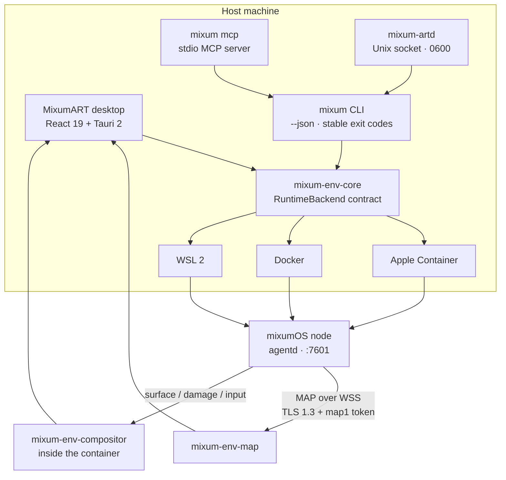

<div align="center">
  
  <h1>MixumART</h1>
  <h3>An early host-side runtime for agents that need a real machine.</h3>
  <p>The host-side runtime for agents that need a real machine: one Tauri app and one CLI that turn<br/><strong>Apple Container</strong>, <strong>Docker</strong> or <strong>WSL 2</strong> into a disposable, inspectable mixumOS environment.</p>
  <p>
    <a href="LICENSE"></a>
    <a href="https://www.rust-lang.org/"></a>
    <a href="https://v2.tauri.app/"></a>
    <a href="https://github.com/EmergeShift/MixumART"></a>
    <a href="https://github.com/EmergeShift/MixumART"></a>
  </p>
  <p><a href="README.zh-CN.md">简体中文</a> · <strong>English</strong></p>
</div>

> **Status: v0.1.0, alpha.** This is an early, unfinished build. The macOS + Apple Container path is the one we use daily; Docker and WSL 2 are implemented but not equally exercised. APIs will move. Packaging is deliberately rough — see the [alpha notes](ALPHA.md).

---

## The problem

Calling an API is not the same as using a computer.

Agents increasingly need to install packages, run a browser, click through a desktop app, recover from a bad command, and hand the whole session to a human. Hosted sandboxes tend to be black boxes; bare container CLIs leave too much to assemble. We wanted **a real machine with a desktop, managed from the host and driven by an agent** — so we built one, imperfectly.

MixumART is the host-side layer that closes that gap. It does not reimplement the sandbox: it consumes [mixumOS](https://github.com/EmergeShift/mixumOS) and speaks [MAP](https://github.com/EmergeShift/Mixum-Agent-Protocol). It owns the part that must live on your laptop: runtime discovery, environment lifecycle, credentials, ports, windows and the control plane agents talk to.

## What it does today

| | |
|---|---|
| **Three runtime backends, one contract** | Apple Container (macOS), Docker, WSL 2. Probe, list, create, start/stop, remove — with a stable `RuntimeBackend` trait and platform code confined to the backend crates. |
| **Apple Container, without the ceremony** | On Apple Silicon, `container` starts a Linux VM in about a second. MixumART discovers it, creates the node, publishes only `127.0.0.1`, reads the node token, pins the TLS fingerprint and opens windows. No Docker Desktop required. |
| **A GUI made of native windows** | The agent's Wayland surfaces stream over MAP as buffer + damage. macOS renders them through **MTKView + Metal**, not a video-in-a-browser-tab. Input, IME and clipboard are routed back into the sandbox. |
| **An agent-native control plane** | `mixum` is a real CLI with `--json` and stable exit codes. `mixum mcp` is a stdio MCP server. `mixum-artd` exposes the same rules over a user-only Unix socket. A bundled skill teaches agents the workflow. |
| **Snapshots and environments** | List and create snapshots, restore in place, inspect windows, stream logs, attach a persistent PTY. Snapshot export/import and one-step migration to a new environment are in progress on the migration branch. |
| **Local by construction** | No hosted account. Ports bind to loopback. Tokens live in the OS keychain and are never printed. External commands are executed as argv, never through a shell. This build sends no telemetry. |
| **Rust where it counts** | Tauri shell, runtime backends, MAP client, compositor and CLI are Rust. React 19 is the view layer. The host-side control plane is one Cargo workspace, kept clippy-clean with `-D warnings`. |

### Why Rust

The same Rust workspace contains the runtime contract (`mixum-env-core`), the three backends, the MAP WSS client (`mixum-env-map`), the surface protocol (`mixum-env-surface`), the in-container compositor (`mixum-env-compositor`), the host-side display client and the CLI/daemon. That means:

- one `Result`/error model from CLI to GUI, with error codes stable enough for agents;
- no shell-string construction anywhere — `process::run` takes an argv vector and a timeout;
- platform differences isolated behind `cfg(target_os)` in the backend crates;
- the agent-facing commands (`mixum --json`, `mixum mcp`) and the GUI share exactly the same implementation, so they cannot drift.

### Apple Container is a first-class backend

Apple Container is not "Docker with a different binary". It runs Linux containers inside lightweight VMs, with APFS clonefile sharing, a host-wide kernel setting, and its own CLI semantics. MixumART handles those differences explicitly:

- probes `container system status` and reports *not installed* vs *not running* as distinct states;
- chooses Apple Container first on macOS when no runtime is specified;
- publishes the MAP port to `127.0.0.1` only;
- reads the node's admin token through the local runtime, never from a file the user has to paste;
- understands the custom `linux-mixum-micro` kernel (CRIU/Landlock enabled) documented in [mixumOS](https://github.com/EmergeShift/mixumOS/blob/main/docs/apple-container.md).

Measured on an M1 / 16 GB / macOS 26.6 with `container` 1.5.0: a full node (agentd + mixcomp) used **≈38 MiB** of RAM, a second container from the same image added **0 MB** of physical disk, and warm container start was **≈1.0 s**. Those are mixumOS numbers; MixumART adds the host UI and control plane, not a second copy of the sandbox.

## Architecture



| Layer | Crate / path | Responsibility |
|---|---|---|
| Domain + contract | `crates/mixum-env-core` | `Container`, `CreateSpec`, `RuntimeKind`, `RuntimeBackend`, `EnvError`, timed process execution |
| Backends | `crates/mixum-env-runtime-{apple,docker,wsl2}` | CLI probing, parsing, lifecycle; all platform code lives here |
| Map client | `crates/mixum-env-map` | WSS connect, TOFU pinning, `display.*`, input, clipboard |
| Display | `crates/mixum-env-surface`, `mixum-env-display` | Surface/frame/patch wire types and the host-side debug viewer |
| Compositor | `crates/mixum-env-compositor` | Smithay headless compositor (Linux, inside the container) |
| Control plane | `crates/mixum-cli` | `mixum`, `mixum-artd`, MCP server, browser monitor, PTY |
| Desktop | `apps/desktop` | Tauri shell, commands, Metal overlay, React views |

### Two display paths, one host

mixumOS can capture windows in two ways, and MixumART can show both at once:

- **A — mixcomp capture.** The compositor inside mixumOS captures each window and streams JPEG/H.264/PNG frames over MAP. The host shows one window per surface and labels the source **A**.
- **B — MixumART compositor.** `mixum-env-compositor` runs inside the container as a Smithay headless compositor and forwards each surface's buffer + damage. The host maintains the base texture and uploads only dirty regions. This path keeps text pixel-perfect and gives the host a surface tree.

The window page lists both, routes input to the correct owner, and lets you fall back to A per window. On macOS the B path is rendered by a native **MTKView/Metal** overlay; other platforms (or `MIXUM_NATIVE_METAL=0`) fall back to a WebView canvas with identical input handling.

## Quick start

### Prerequisites

| Requirement | Notes |
|---|---|
| Rust | stable; the workspace is tested with 1.97 |
| Node.js | 20+ (24 tested) for the desktop UI |
| A runtime | Apple Container on macOS, Docker, or WSL 2 on Windows |
| A mixumOS image | Build one with `make dist` in [mixumOS](https://github.com/EmergeShift/mixumOS), or use an image from a release |
| Platform toolchain | Xcode CLT (macOS), WebView2 + MSVC (Windows), webkit2gtk (Linux, Tauri prerequisites) |

On macOS with Apple Container, the host setup is two commands:

```bash
brew install container
container system start
```

Then pass `--runtime apple` to `mixum env create`. If more than one runtime is ready, the CLI requires an explicit `--runtime`.

### 1. Build the CLI and check the host

```bash
cargo build --release -p mixum-cli

./target/release/mixum doctor
./target/release/mixum runtime list
```

`doctor` prints the data directory, the three backends, their state and the port range. A missing runtime is a **state**, not an error: the CLI tells you what to install or start.

### 2. Create an environment

```bash
# The image must contain agentd, mixcomp and /entrypoint.sh,
# and its reference must contain "mixumos" for --profile mixumos.
./target/release/mixum env create \
  --profile mixumos \
  --title "fix login" \
  --image mixumos:0.1.5 \
  --runtime apple

./target/release/mixum env list
./target/release/mixum env windows "fix login"
```

The CLI picks a free host port in `17600–17999`, publishes it on `127.0.0.1` only, waits for MAP, pins the certificate fingerprint and records the title in a local registry (`0600`). Use `--profile generic` for a plain container with no agentd and no window stream.

### 3. Open a window

```bash
# Read-only browser monitor for one surface; prints the URL.
# Omit --window when the environment has exactly one surface;
# otherwise take the id from `mixum env windows`.
./target/release/mixum env open "fix login" --no-open

# Or use the desktop app:
cd apps/desktop
npm install
npm run tauri dev
```

The desktop's **Windows** page connects over MAP WSS, lists surfaces from both A and B, opens one native window per surface, and supports `Ctrl/Cmd+Shift+T` takeover.

### 4. Give the agent the control plane

```bash
# stdio MCP server — one tool per safe operation.
./target/release/mixum mcp
```

Example client configuration:

```json
{
  "mcpServers": {
    "mixum": {
      "command": "/absolute/path/to/mixum",
      "args": ["mcp"]
    }
  }
}
```

Tools exposed over MCP: `mixum_env_list`, `mixum_env_create`, `mixum_env_show`, `mixum_env_windows`, `mixum_env_start`, `mixum_env_stop`, `mixum_snapshot_list`, `mixum_snapshot_create`, `mixum_port_check`.

Terminal access, arbitrary shells and destructive snapshot restore are deliberately **not** exposed over MCP. The CLI still provides them locally, with `--yes` required for restore. The bundled agent instructions live in [`skills/mixum-art/SKILL.md`](skills/mixum-art/SKILL.md).

### 5. Optional: a daemon for long-lived clients

```bash
./target/release/mixum-artd
# default socket: <data-dir>/artd.sock, mode 0600
```

The daemon speaks one JSON request per line and one JSON response per line, using the same error codes as the CLI. It shells out to the sibling `mixum --json` binary, so port allocation, state and MAP rules have exactly one implementation. See [docs/daemon.md](docs/daemon.md).

## CLI at a glance

Every command supports `--json`; errors are machine-readable and exit codes are stable (`0` ok, `1` IO, `2` usage, `3` not found, `4` conflict, `5` runtime, `6` MAP).

| Command | Purpose |
|---|---|
| `mixum doctor` | Runtimes, data dir, port range, actionable hints |
| `mixum runtime list` | Backend availability and versions |
| `mixum env list [--all]` | Managed environments; `--all` includes every runtime container |
| `mixum env create` | Create a mixumOS or generic environment |
| `mixum env show / start / stop / remove` | Lifecycle |
| `mixum env windows` | List MAP windows (A and B) |
| `mixum env open` | Read-only browser monitor for one surface |
| `mixum env logs / terminal` | Logs and a persistent PTY |
| `mixum env snapshot list / create / restore` | Snapshot control through MAP |
| `mixum port check / list` | Loopback port diagnosis |
| `mixum config show / set / unset` | Default runtime and image |
| `mixum desktop` | Open the installed desktop app |
| `mixum mcp` | stdio MCP server |
| `mixum version` | Version and build information |

Full contract, selectors and JSON shapes: [docs/cli.md](docs/cli.md).

## Alpha notes

MixumART is alpha. The macOS app is unsigned (no Apple Developer Program yet),
Windows shows SmartScreen, and the browser bridge is developer-mode only until a
store listing exists. [ALPHA.md](ALPHA.md) has the exact steps and the reason;
none of this affects the CLI, Docker images, or the npm SDK.

## Platform support

| Capability | macOS | Windows | Linux |
|---|---|---|---|
| Apple Container | ✅ probe / list / create / start-stop / remove — verified | — | — |
| Docker | ✅ verified | ✅ implemented; not hardware-validated | ✅ implemented; not hardware-validated |
| WSL 2 | — | ✅ probe / list / import / start-stop / unregister; full rootfs import not yet validated in-app | — |
| Desktop app | ✅ verified | ✅ code path; not hardware-validated | ✅ code path; not hardware-validated |
| Native Metal surface | ✅ MTKView + Metal | — | — (WebView canvas) |
| A + B display | ✅ | ✅ code path | ✅ code path |
| Input / IME / clipboard | ✅ | ✅ code path | ✅ code path |

"Implemented" means the code path exists and compiles for that target. "Verified" means it was exercised on real hardware. We try to keep the distinction; admitting a gap is more useful than claiming coverage we have not exercised.

## Security model

- **No shell interpolation.** Every external command is an argv vector with a timeout; the process layer refuses shell strings.
- **Loopback only.** The MAP port is published to `127.0.0.1`; the browser monitor binds to loopback; the daemon socket is `0600` inside a `0700` data directory.
- **Credentials stay local.** Connection tokens and agent credentials go to the OS keychain. The CLI reads the node's admin token through the local runtime on demand and never prints it; `env logs` redacts `map1.…`.
- **Pin the node.** MAP connections use TLS 1.3 and TOFU certificate pinning, stored per host in `~/.mixum/known-hosts` (or the app data directory). A changed fingerprint is a hard failure.
- **Least privilege in Tauri.** The desktop only enables the capabilities it needs; platform logic stays in Rust, not in the webview.
- **No telemetry in this build.** MixumART does not phone home; there is no account and no update beacon. Any future opt-in analytics would be documented in the ecosystem [TRUST commitments](https://github.com/EmergeShift/Mixum-Agent-Protocol/blob/main/TRUST.md) and off by default.

The full runtime contract and error mapping are in [docs/runtime-contract.md](docs/runtime-contract.md); the display threat model is in [docs/display.md](docs/display.md).

## Where we could be wrong

We are not sure the host/runtime split is the right boundary, that a native Metal
overlay is worth its complexity over a plain WebView, or that Docker and WSL 2 can
be supported to the same depth as Apple Container. Packaging is also rough: the
app is unsigned, and the browser bridge is developer-mode only.

If you have shipped a desktop runtime, a compositor or a cross-platform installer,
tell us what you would change first. We would rather hear it now.

## Status and roadmap

| Area | State |
|---|---|
| Tauri 2 desktop, React views, native Metal surface | ✅ macOS verified |
| `mixum` CLI (`--json`, stable exit codes) | ✅ |
| `mixum mcp` (9 tools) + `skills/mixum-art` | ✅ |
| `mixum-artd` Unix socket API | ✅ |
| Apple Container backend | ✅ verified on macOS 26 / M1 |
| Docker backend | ✅ verified on macOS; Windows/Linux code paths unvalidated |
| WSL 2 backend | ✅ implemented; import path not fully validated |
| A/B display, input, IME, clipboard, XWayland | ✅ B0–B3 |
| Snapshot export/import, new-environment migration (`.mart`) | 🚧 feature branch, merging before the next release |
| Browser `serve` UI | 🚧 read-only `env open` works; full UI pending |
| GPU / dmabuf zero-copy | ⏳ waiting on stable virtio-gpu/venus |
| Cross-VM XDND file drag | ⏳ text/URI drop works; file drag-out pending |

## Repository map

```text
MixumART/
├── crates/
│   ├── mixum-env-core/           domain types, RuntimeBackend contract, timed process
│   ├── mixum-env-runtime-apple/  Apple Container backend
│   ├── mixum-env-runtime-docker/ Docker backend
│   ├── mixum-env-runtime-wsl2/   WSL 2 backend
│   ├── mixum-env-map/            MAP WSS client, TOFU, display/input
│   ├── mixum-env-surface/        surface/frame/input wire types
│   ├── mixum-env-compositor/     Smithay headless compositor (container side)
│   ├── mixum-env-display/        host TCP viewer / debug client
│   └── mixum-cli/                mixum, mixum-artd, MCP, browser monitor, PTY
├── apps/desktop/                 Tauri shell + React UI
├── skills/mixum-art/             agent-facing workflow
├── docs/                         architecture, CLI, daemon, display, contract, UI
└── Cargo.toml                    one workspace, three backends
```

## Documentation

| Document | Contents |
|---|---|
| [Architecture](docs/architecture.md) | Positioning, division of labor with mixumOS, process model, roadmap |
| [CLI](docs/cli.md) | Command contract, ports, selectors, JSON, exit codes |
| [Daemon](docs/daemon.md) | `mixum-artd` protocol and methods |
| [Display](docs/display.md) | B-route compositor, surface/damage, input, Metal, XWayland |
| [Runtime contract](docs/runtime-contract.md) | Backend semantics, errors, serialization |
| [UI](docs/ui.md) | View structure, design tokens, copy |
| [Contributing](docs/contributing.md) | Environment, commands, cross-platform rules, known pits |

Most design documents are currently written in Chinese; the CLI/daemon contracts and the tests are the English-readable source of truth. Translation help is welcome.

## Ecosystem

| Project | Role |
|---|---|
| [mixumOS](https://github.com/EmergeShift/mixumOS) | The agent OS and MAP Node that runs inside the environment |
| **MixumART** (this repo) | The host runtime: lifecycle, CLI/MCP, windows, credentials |
| [Mixum Agent Protocol](https://github.com/EmergeShift/Mixum-Agent-Protocol) | The open contract between clients, hosts and nodes |

## Contributing

```bash
cargo check --workspace --all-targets
cargo test --workspace
cargo fmt --all
cargo clippy --workspace --all-targets -- -D warnings

cd apps/desktop && npm ci && npm run build
```

Keep platform differences inside `crates/mixum-env-runtime-*`. Do not add `cfg(target_os)` to `mixum-env-core`. Frontend commands go through `src/api.ts`; new Tauri commands must be registered in `generate_handler!`. See [docs/contributing.md](docs/contributing.md) before opening a PR.

## License

[Apache-2.0](LICENSE). Third-party components keep their own licenses; see [THIRD_PARTY_NOTICES.md](THIRD_PARTY_NOTICES.md).

---

<div align="center">
  <sub>Give the agent a computer. Keep the computer on your desk.</sub>
</div>
