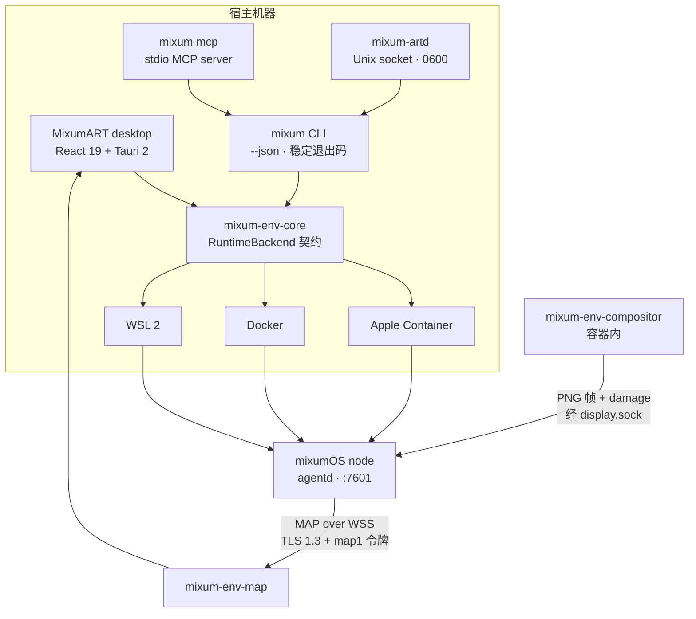

<div align="center">
  
  <h1>MixumART</h1>
  <h3>一个仍在早期的宿主侧运行时：给需要真机的 agent 一台真机。</h3>
  <p>面向“需要一台真机器”的 agent 的宿主侧运行时：一个 Tauri 应用加一个 CLI，把<br/><strong>Apple Container</strong>、<strong>Docker</strong> 或 <strong>WSL 2</strong> 变成可丢弃、可检查的 mixumOS 环境。</p>
  <p>
    <a href="LICENSE"></a>
    <a href="https://www.rust-lang.org/"></a>
    <a href="https://v2.tauri.app/"></a>
    <a href="https://github.com/EmergeShift/MixumART"></a>
    <a href="https://github.com/EmergeShift/MixumART"></a>
  </p>
  <p><strong>简体中文</strong> · <a href="README.md">English</a></p>
</div>

> **状态：v0.1.0，alpha。** 这是一个早期、未完成的构建。macOS + Apple Container 是我们每天在用的路径；Docker 与 WSL 2 已实现，但验证程度不同。API 仍会变，打包也刻意做得很轻——见 [Alpha 说明](ALPHA.zh-CN.md)。

---

## 要解决什么

能调用 API，不等于能用一台电脑。

agent 越来越需要装包、开浏览器、在桌面应用里点来点去、从一条错误命令里恢复，并把整个会话交给人类。托管沙箱往往是个黑盒；裸容器 CLI 又留下太多东西要自己拼。我们想要**一台带桌面、由宿主管理、能被 agent 驱动的真机器**——于是自己搭了一个，还不完美。

MixumART 就是补上这一层的宿主侧软件。它不重新实现沙箱：它消费 [mixumOS](https://github.com/EmergeShift/mixumOS)，说 [MAP](https://github.com/EmergeShift/Mixum-Agent-Protocol) 协议。它负责必须留在你笔记本上的部分：运行时发现、环境生命周期、凭据、端口、窗口，以及 agent 使用的控制面。

## 目前能做什么

| | |
|---|---|
| **三种运行时，一个契约** | Apple Container（macOS）、Docker、WSL 2。探测、列举、创建、启停、删除——统一在稳定的 `RuntimeBackend` trait 下，平台代码只存在于后端 crate。 |
| **Apple Container，不用折腾** | Apple Silicon 上 `container` 启动 Linux VM 约一秒。MixumART 自动发现它、创建节点、只发布 `127.0.0.1`、读取节点令牌、固定 TLS 指纹并打开窗口。不需要 Docker Desktop。 |
| **由原生窗口组成的 GUI** | agent 的 Wayland surface 以 buffer + damage 经 MAP 传到宿主。macOS 用 **MTKView + Metal** 渲染，而不是“浏览器标签页里放视频”。输入、输入法和剪贴板会回传到沙箱。 |
| **agent 原生控制面** | `mixum` 是带 `--json` 和稳定退出码的真 CLI；`mixum mcp` 是 stdio MCP server；`mixum-artd` 通过仅当前用户可访问的 Unix socket 暴露同一套规则；随仓库附带教 agent 使用的工作流 skill。 |
| **快照与环境** | 列举/创建快照、原地恢复、查看窗口、看日志、挂持久 PTY。快照导出/导入与“一键迁移到新环境”正在 migration 分支推进。 |
| **默认本地** | 无托管账号。端口只绑回环。令牌进系统钥匙串，从不打印。外部命令按 argv 执行，永远不过 shell。当前构建不回传任何遥测。 |
| **Rust 是骨架** | Tauri 壳、运行时后端、MAP 客户端、合成器与 CLI 都是 Rust；React 19 只是视图层。宿主控制面是一个 Cargo workspace。 |

### 为什么用 Rust

同一个 Rust workspace 里放着运行时契约（`mixum-env-core`）、三个后端、MAP WSS 客户端（`mixum-env-map`）、surface 协议（`mixum-env-surface`）、容器内合成器（`mixum-env-compositor`）、宿主显示客户端和 CLI/daemon。带来的是：

- 从 CLI 到 GUI 只有一套 `Result`/错误模型，错误码稳定到 agent 可以编程处理；
- 任何地方都不拼接 shell 字符串——`process::run` 只接受 argv 数组和超时；
- 平台差异被关在后端 crate 的 `cfg(target_os)` 内；
- 面向 agent 的命令（`mixum --json`、`mixum mcp`）和 GUI 共用同一份实现，不可能行为漂移。

### Apple Container 是一等后端

Apple Container 不是“换了个二进制的 Docker”。它把 Linux 容器跑在轻量 VM 里，有 APFS clonefile 共享、宿主级全局内核设置和一套自己的 CLI 语义。MixumART 显式处理这些差异：

- 探测 `container system status`，把“未安装”和“未启动”区分成不同状态；
- macOS 上未指定运行时则优先选 Apple Container；
- MAP 端口只发布到 `127.0.0.1`；
- 通过本地运行时按需读取节点 admin 令牌，不需要用户手工粘贴；
- 理解 mixumOS 的自研 `linux-mixum-micro` 内核（开启 CRIU/Landlock），见 [mixumOS 内核说明](https://github.com/EmergeShift/mixumOS/blob/main/docs/apple-container.md)。

在 M1 / 16 GB / macOS 26.6 / `container` 1.5.0 上实测：完整节点（agentd + mixcomp）常驻 **≈38 MiB** 内存；同镜像再起一个容器，物理磁盘净增 **0 MB**；容器热启动 **≈1.0 s**。这些是 mixumOS 的数字；MixumART 增加的是宿主 UI 和控制面，不是第二份沙箱。

## 架构



两个合成器都是 Node 显示 broker（`/run/mixum/display.sock`）的客户端；
只有 broker 通过 MAP over WSS 连到宿主的 `mixum-env-map`，容器内的合成器不会
直接穿墙连宿主 UI。

| 层 | Crate / 路径 | 职责 |
|---|---|---|
| 领域与契约 | `crates/mixum-env-core` | `Container`、`CreateSpec`、`RuntimeKind`、`RuntimeBackend`、`EnvError`、带超时的进程调用 |
| 后端 | `crates/mixum-env-runtime-{apple,docker,wsl2}` | CLI 探测、解析、生命周期；所有平台代码只在这里 |
| MAP 客户端 | `crates/mixum-env-map` | WSS 连接、TOFU 固定、`display.*`、输入、剪贴板 |
| 显示 | `crates/mixum-env-surface`、`mixum-env-display` | surface/frame/patch 线格式与宿主调试查看器 |
| 合成器 | `crates/mixum-env-compositor` | Smithay headless 合成器（Linux，容器内） |
| 控制面 | `crates/mixum-cli` | `mixum`、`mixum-artd`、MCP server、浏览器监看、PTY |
| 桌面端 | `apps/desktop` | Tauri 壳、命令、Metal 叠加层、React 视图 |

### 两条显示路径，一个宿主

mixumOS 有两种窗口捕获方式，MixumART 可以同时显示：

- **A — mixcomp 捕获。** mixumOS 内的合成器逐窗口捕获，默认经 MAP 推 PNG 脏区补丁，JPEG/H.264 作为回退。宿主每个 surface 一个窗口，标为 **A**。
- **B — MixumART 合成器。** `mixum-env-compositor` 在容器内作为 Smithay headless 合成器运行，转发每个 surface 的 buffer + damage。宿主维护基础纹理，只上传脏区。这条路径文字像素级保真，并让宿主拿到 surface 树。

窗口页同时列出 A/B，按 owner 路由输入，并支持按窗口回退到 A。macOS 上 B 路径由原生 **MTKView/Metal** 叠加层渲染；其他平台（或 `MIXUM_NATIVE_METAL=0`）回退到 WebView canvas，输入处理完全一致。

## 快速开始

### 前置条件

| 项 | 说明 |
|---|---|
| Rust | stable；本仓库在 1.97 上验证 |
| Node.js | 20+（24 已验证），用于桌面 UI |
| 运行时 | macOS 用 Apple Container，或 Docker；Windows 用 WSL 2 |
| mixumOS 镜像 | 在 [mixumOS](https://github.com/EmergeShift/mixumOS) 里 `make dist` 构建，或使用 release 镜像 |
| 平台工具链 | Xcode CLT（macOS）、WebView2 + MSVC（Windows）、webkit2gtk（Linux，见 Tauri 前置） |

macOS 上使用 Apple Container，宿主侧只需两条命令：

```bash
brew install container
container system start
```

然后给 `mixum env create` 传 `--runtime apple`。如果同时有多个运行时可用，CLI 会要求显式指定 `--runtime`。

### 1. 构建 CLI，检查宿主

```bash
cargo build --release -p mixum-cli

./target/release/mixum doctor
./target/release/mixum runtime list
```

`doctor` 会打印数据目录、三个后端、各自状态和端口范围。运行时缺失是**状态**而不是错误：CLI 会告诉你该装什么、该启动什么。

### 2. 创建环境

```bash
# 镜像必须带 agentd、mixcomp 和 /entrypoint.sh；
# --profile mixumos 要求镜像引用里包含 "mixumos"。
./target/release/mixum env create \
  --profile mixumos \
  --title "fix login" \
  --image mixumos:0.1.5 \
  --runtime apple

./target/release/mixum env list
./target/release/mixum env windows "fix login"
```

CLI 会从 `17600–17999` 选一个空闲宿主端口，只发布到 `127.0.0.1`，等待 MAP 就绪，固定证书指纹，并把标题写进本地注册表（`0600`）。`--profile generic` 用于不需要 agentd、不需要窗口流的普通容器。

### 3. 打开窗口

```bash
# 单个 surface 的只读浏览器监看；只打印 URL。
# 环境只有一个 surface 时可省略 --window；
# 多窗口时从 `mixum env windows` 里取 id。
./target/release/mixum env open "fix login" --no-open

# 或者用桌面端：
cd apps/desktop
npm install
npm run tauri dev
```

桌面端的**窗口**页通过 MAP WSS 连接，列出 A/B 两路 surface，为每个 surface 打开一个原生窗口，并支持 `Ctrl/Cmd+Shift+T` 接管。

### 4. 把控制面交给 agent

```bash
# stdio MCP server —— 每个安全操作一个工具。
./target/release/mixum mcp
```

客户端配置示例：

```json
{
  "mcpServers": {
    "mixum": {
      "command": "/absolute/path/to/mixum",
      "args": ["mcp"]
    }
  }
}
```

MCP 暴露的工具：`mixum_env_list`、`mixum_env_create`、`mixum_env_show`、`mixum_env_windows`、`mixum_env_start`、`mixum_env_stop`、`mixum_snapshot_list`、`mixum_snapshot_create`、`mixum_port_check`。

终端、任意 shell 和破坏性快照恢复**故意不**通过 MCP 暴露。CLI 仍可在本地使用，restore 必须带 `--yes`。随仓库附带的 agent 指令在 [`skills/mixum-art/SKILL.md`](skills/mixum-art/SKILL.md)。

### 5. 可选：给长驻客户端一个 daemon

```bash
./target/release/mixum-artd
# 默认 socket：<data-dir>/artd.sock，权限 0600
```

daemon 一行一个 JSON 请求、一行一个 JSON 响应，错误码与 CLI 一致。它调用同目录的 `mixum --json`，因此端口分配、状态与 MAP 规则只有一份实现。见 [docs/daemon.zh-CN.md](docs/daemon.zh-CN.md)。

## CLI 速览

所有命令支持 `--json`；错误是机器可读的，退出码稳定（`0` 成功，`1` IO，`2` 参数，`3` 未找到，`4` 冲突，`5` 运行时，`6` MAP）。

| 命令 | 用途 |
|---|---|
| `mixum doctor` | 运行时、数据目录、端口范围、可执行的提示 |
| `mixum runtime list` | 后端可用性与版本 |
| `mixum env list [--all]` | 已托管环境；`--all` 包含运行时里的所有容器 |
| `mixum env create` | 创建 mixumOS 或 generic 环境 |
| `mixum env show / start / stop / remove` | 生命周期 |
| `mixum env windows` | 列出 MAP 窗口（A/B） |
| `mixum env open` | 单个 surface 的只读浏览器监看 |
| `mixum env logs / terminal` | 日志与持久 PTY |
| `mixum env snapshot list / create / restore` | 通过 MAP 控制快照 |
| `mixum port check / list` | 回环端口诊断 |
| `mixum config show / set / unset` | 默认运行时与镜像 |
| `mixum desktop` | 打开已安装的桌面端 |
| `mixum mcp` | stdio MCP server |
| `mixum version` | 版本与构建信息 |

完整契约、selector 与 JSON 形状见 [docs/cli.zh-CN.md](docs/cli.zh-CN.md)。

## Alpha 说明

MixumART 是 alpha。macOS 应用没有签名（还没买 Apple Developer Program），Windows 会弹 SmartScreen，浏览器桥在商店上架前只能用开发者模式。具体步骤和原因在 [ALPHA.zh-CN.md](ALPHA.zh-CN.md)；CLI、Docker 镜像和 npm SDK 不受影响。

## 平台支持

| 能力 | macOS | Windows | Linux |
|---|---|---|---|
| Apple Container | ✅ 探测 / 列举 / 创建 / 启停 / 删除 —— 已验证 | — | — |
| Docker | ✅ 已验证 | ✅ 已实现；未真机验证 | ✅ 已实现；未真机验证 |
| WSL 2 | — | ✅ 探测 / 列举 / 导入 / 启停 / 注销；完整 rootfs 导入尚未在应用内验证 | — |
| 桌面端 | ✅ 已验证 | ✅ 代码路径；未真机验证 | ✅ 代码路径；未真机验证 |
| Metal 原生 surface | ✅ MTKView + Metal | — | —（WebView canvas） |
| A + B 显示 | ✅ | ✅ 代码路径 | ✅ 代码路径 |
| 输入 / 输入法 / 剪贴板 | ✅ | ✅ 代码路径 | ✅ 代码路径 |

“已实现”指代码存在且该目标能编译；“已验证”指在真实硬件上跑过。我们尽量保留这个区分；承认没跑过的平台，比声称覆盖更有用。

## 安全模型

- **不拼接 shell。** 所有外部命令都是带超时的 argv 数组；进程层拒绝 shell 字符串。
- **只走回环。** MAP 端口发布到 `127.0.0.1`；浏览器监看只绑回环；daemon socket 权限 `0600`，位于 `0700` 数据目录。
- **凭据留在本地。** 连接令牌和 agent 凭据进系统钥匙串。CLI 按需通过本地运行时读取节点 admin 令牌，从不打印；`env logs` 会把 `map1.…` 脱敏。
- **固定节点。** MAP 连接使用 TLS 1.3 与 TOFU 证书固定，按主机记录在 `~/.mixum/known-hosts`（或应用数据目录）。指纹变化即硬失败。
- **Tauri 最小权限。** 桌面端只开需要的 capability；平台逻辑留在 Rust，不放进 webview。
- **当前构建不含遥测。** MixumART 不回传数据，没有账号，也没有更新信标。未来若加入可选统计，会在生态级 [TRUST 承诺](https://github.com/EmergeShift/Mixum-Agent-Protocol/blob/main/TRUST.md)中说明，且默认关闭。

运行时契约与错误映射见 [docs/runtime-contract.md](docs/runtime-contract.md)；显示威胁模型见 [docs/display.zh-CN.md](docs/display.zh-CN.md)。

## 我们可能错在哪

我们不确定“宿主/运行时”的切分是不是对的边界，不确定原生 Metal 叠加层是否值得它带来的复杂度，也不确定 Docker 和 WSL 2 能不能做到和 Apple Container 同样的深度。打包也还很糙：应用没签名，浏览器桥只能用开发者模式。

如果你做过桌面运行时、合成器或跨平台安装器，欢迎直接说你会先改哪里。我们宁愿现在听到。

## 状态与路线图

| 领域 | 状态 |
|---|---|
| Tauri 2 桌面端、React 视图、Metal 原生 surface | ✅ macOS 已验证 |
| `mixum` CLI（`--json`、稳定退出码） | ✅ |
| `mixum mcp`（9 个工具）+ `skills/mixum-art` | ✅ |
| `mixum-artd` Unix socket API | ✅ |
| Apple Container 后端 | ✅ macOS 26 / M1 已验证 |
| Docker 后端 | ✅ macOS 已验证；Windows/Linux 代码路径未验证 |
| WSL 2 后端 | ✅ 已实现；导入路径未完整验证 |
| A/B 显示、输入、输入法、剪贴板、XWayland | ✅ B0–B3 |
| 快照导出/导入、新环境迁移（`.mart`） | 🚧 migration 分支，下次发布前合并 |
| 浏览器 `serve` UI | 🚧 只读 `env open` 可用；完整 UI 待补 |
| GPU / dmabuf 零拷贝 | ⏳ 等待稳定的 virtio-gpu/venus |
| 跨 VM XDND 文件拖拽 | ⏳ 文本/URI 拖入可用；文件 drag-out 待补 |

## 仓库地图

```text
MixumART/
├── crates/
│   ├── mixum-env-core/           领域类型、RuntimeBackend 契约、带超时进程
│   ├── mixum-env-runtime-apple/  Apple Container 后端
│   ├── mixum-env-runtime-docker/ Docker 后端
│   ├── mixum-env-runtime-wsl2/   WSL 2 后端
│   ├── mixum-env-map/            MAP WSS 客户端、TOFU、display/input
│   ├── mixum-env-surface/        surface/frame/input 线格式
│   ├── mixum-env-compositor/     Smithay headless 合成器（容器侧）
│   ├── mixum-env-display/        宿主 TCP 查看器 / 调试客户端
│   └── mixum-cli/                mixum、mixum-artd、MCP、浏览器监看、PTY
├── apps/desktop/                 Tauri 壳 + React UI
├── skills/mixum-art/             面向 agent 的工作流
├── docs/                         架构、CLI、daemon、显示、契约、UI
└── Cargo.toml                    一个 workspace，三个后端
```

## 文档

| 文档 | 内容 |
|---|---|
| [架构](docs/architecture.zh-CN.md) | 定位、与 mixumOS 的分工、进程模型、路线图 |
| [CLI](docs/cli.zh-CN.md) | 命令契约、端口、selector、JSON、退出码 |
| [Daemon](docs/daemon.zh-CN.md) | `mixum-artd` 协议与方法 |
| [显示](docs/display.zh-CN.md) | B 路线合成器、surface/damage、输入、Metal、XWayland |
| [运行时契约](docs/runtime-contract.md) | 后端语义、错误、序列化 |
| [界面](docs/ui.md) | 视图结构、设计 token、文案 |
| [贡献](docs/contributing.md) | 环境、命令、跨平台规则、已知坑 |

设计文档目前以中文为主；CLI/daemon 契约与测试是可读的英文事实来源。欢迎帮忙翻译。

## 生态

| 项目 | 角色 |
|---|---|
| [mixumOS](https://github.com/EmergeShift/mixumOS) | 跑在环境里的 agent OS 与 MAP Node |
| **MixumART**（本仓库） | 宿主运行时：生命周期、CLI/MCP、窗口、凭据 |
| [Mixum Agent Protocol](https://github.com/EmergeShift/Mixum-Agent-Protocol) | 客户端、宿主与节点之间的开放契约 |

## 参与贡献

```bash
cargo check --workspace --all-targets
cargo test --workspace
cargo fmt --all
cargo clippy --workspace --all-targets -- -D warnings

cd apps/desktop && npm ci && npm run build
```

平台差异只放在 `crates/mixum-env-runtime-*`。不要把 `cfg(target_os)` 加进 `mixum-env-core`。前端命令统一走 `src/api.ts`；新增 Tauri 命令必须注册到 `generate_handler!`。开 PR 前先读 [docs/contributing.md](docs/contributing.md)。

## 许可证

[Apache-2.0](LICENSE)。第三方组件遵循各自许可，见 [THIRD_PARTY_NOTICES.md](THIRD_PARTY_NOTICES.md)。

---

<div align="center">
  <sub>给 agent 一台电脑，把电脑留在你的桌上。</sub>
</div>
